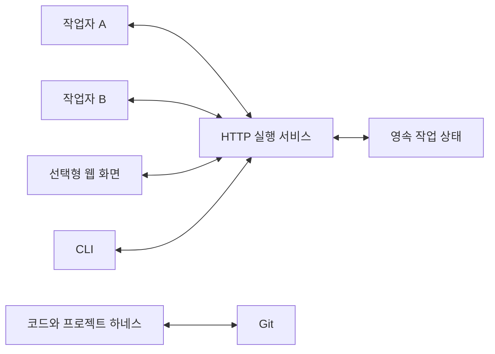

# Stackcord

> 필요한 문맥으로 AI 작업을 조율하고, 세션이 바뀌어도 프로젝트를 이어갑니다.

[](https://github.com/kcrmin/Stackcord/actions/workflows/ci.yml)
[](LICENSE)

[English](README.md)

Stackcord는 AI 작업자를 위한 오픈소스 **협업 라이브러리와 HTTP 실행 서비스**입니다.
작업·checkpoint·결과를 AI 세션과 별도로 보존합니다. 작업자는 구조화된 요청을
HTTP로 주고받으며 **메시지 전달에 Git을 사용하지 않습니다**. Git은 코드·제품 결정·하네스 설정을 관리합니다.

작업자가 중단되거나 사용량 제한을 보고해도 작업 기록은 남습니다. 다른 작업자는
인수 가능한 작업을 맡아 최신 인수인계를 읽고 이어갈 수 있습니다. 돌아온 이전 세션은
새 담당자의 상태를 덮어쓸 수 없습니다. 변경된 이벤트 ID를 확인한 뒤 필요한 작업의
문맥만 읽습니다. 유휴 상태 확인과 웹 화면은 모델을 호출하지 않습니다.

**버전 구분:** 이 소스 체크아웃에는 새 실행 서비스가 있으며, 배포된 `v1.0.0` Plugin에는
포함되지 않습니다. 새 기능은 현재 소스를 빌드해 사용하세요. 새 버전 공개나 기존
Git 채널의 자동 이전을 의미하지 않습니다.

## 사용 방식 선택

| 인터페이스 | 용도 |
| --- | --- |
| [코어 라이브러리](core/README.md) | Go 프로그램에 작업 연속성 내장. CLI·GUI·하네스에 의존하지 않음 |
| [CLI / HTTP](docs/guides/runtime-ko.md) | AI 도구·스크립트 연결, 진행 상황 저장과 복귀 |
| 선택형 웹 화면 | 작업·담당·보고된 사용량·변경 관찰, 작업 생성·재배정 |
| [프로젝트 하네스](docs/guides/harness-ko.md) | 기존 Git·QDD·계약·DBML·UI 기준선·릴리스 기능 |

GUI와 CLI는 같은 코어를 사용하는 어댑터입니다. 같은 저장소에서 Apache-2.0으로
관리하며, 라이브러리는 둘 없이도 사용할 수 있습니다.

## 실행 서비스 시작

현재 소스를 `cli/go.mod`에 명시된 Go 버전으로 빌드합니다.

```sh
cd cli
go build -o ../dist/stackcord ./cmd/stackcord
```

명령 하나로 시작합니다.

```sh
../dist/stackcord start
```

브라우저에서 내 작업 공간이 열립니다. **첫 작업 만들기**를 누르고 할 일을 적은 뒤,
**AI에게 전달**에서 지시문을 복사해 Codex, Claude Code 또는 터미널을 사용할 수 있는
AI 도구에 붙여넣으세요. AI가 보고하는 진행 내용이 화면에 표시됩니다. 작업을 만드는
것만으로 모델이 실행되지는 않습니다.

`start`는 사용자 설정 디렉터리 아래 `Stackcord`에 비공개 인증 파일과 데이터베이스를
만들고 재사용합니다. `127.0.0.1:7331`에서 전경으로 실행됩니다. Ctrl+C로 종료한 뒤
다시 실행하면 이어서 사용할 수 있습니다. 별도 계정, Node runtime, 모델 API 키,
Git 저장소가 필요하지 않습니다. `--no-open`으로 출력된 일회용 링크를 직접 열거나,
`--data-dir`로 다른 비공개 저장 경로를 지정할 수 있습니다.
현재는 소스 빌드이며, 새 설치 프로그램이 배포된 것은 아닙니다.

기본 화면에는 진행할 작업과 그 내용만 표시합니다. 완료한 작업은 **전체 작업**에,
활동 기록·연결 안내·고급 설정은 필요할 때 여는 화면에 있습니다. ID는 자동으로
생성합니다. 기존 `serve --db ... --token-file ... --ui`는 서버를 직접 구성할 때
계속 사용할 수 있습니다.

로컬 세션, 작업 인수, 원격 연결, 백업·복원은
[실행 서비스 안내](docs/guides/runtime-ko.md)를 참고하세요.

## 작은 메시지와 지속되는 작업



- 프로젝트·작업 ID는 작업자 세션이 바뀌어도 유지됩니다.
- 의존성, 만료되는 담당 권한, 세대 번호로 오래된 상태 갱신을 막습니다.
- 같은 요청을 재전송해도 사용량이나 이벤트를 중복 기록하지 않습니다.
- checkpoint에 완료 내용·다음 단계·차단 사유·결과물 참조를 보존합니다.
- 프로젝트별 커서로 전체 대화 대신 작은 변경 목록을 읽습니다.
- 문맥 바이트 예산을 넘으면 필수 제약을 잘라내지 않고 오류를 반환합니다.
- 일관된 데이터베이스 백업으로 소스 저장소와 별개로 상태를 보존합니다.

이 기능들은 같은 문맥을 반복 전달하는 비용을 줄이기 위한 장치입니다.
**토크나이저 기준의 정확한 상한이나 측정하지 않은 토큰 절감률을 주장하지 않습니다.**
사용량은 작업자가 보고한 값이며, 알 수 없는 사용량은 0이 아닙니다. 절감률은 재작업을
포함한 총 토큰과 작업 성공률을 함께 비교해야 합니다.

## 기존 프로젝트와 기능 범위

`stackcord harness`에서 기존 프로젝트 기능을 사용합니다. `stackcord status`,
`stackcord channel`, `stackcord dashboard` 같은 원래 명령은 숨겨진 호환 경로로
유지합니다. 기존 파일·실행 기록·Git 이력을 이전하거나 삭제하지 않습니다.
이전 대시보드와 서명된 Git 채널은 이 확장에 속합니다.

새 실행 서비스는 모델 자동 실행, 한도 초기화, 모델의 비공개 문맥 이전, 코드 결과
검증을 하지 않습니다. 기존 자동 실행기는 하네스에 유지하며 작업자는 새 CLI/API를
명시적으로 사용합니다. 담당 권한 만료가 이전 프로세스의 종료를 보장하지는 않습니다.
코드 실행을 격리하고 통합 전에 Git 결과를 검증하세요. 하나의 인증값은 신뢰하는 팀의
전체 상태에 접근할 수 있으므로 신뢰하지 않는 팀은 실행 서비스를 분리하세요.

실행 데이터베이스는 **원본 상태이며 캐시가 아닙니다**. Git 밖의 로컬 디스크에
보관하고 백업하세요. 원격 작업자는 HTTPS나 SSH 터널로 연결하며 데이터베이스 파일을
컴퓨터 사이에 직접 공유하지 않습니다.

## 개발

- [아키텍처와 기능 평가](docs/design/coordination-core.md)
- [코어 API](core/README.md)
- [실행 서비스와 이전 경계](docs/guides/runtime-ko.md)
- [선택형 하네스](docs/guides/harness-ko.md)
- [기여와 검증](CONTRIBUTING.md)
- [보안](SECURITY.md) · [라이선스](LICENSE)
