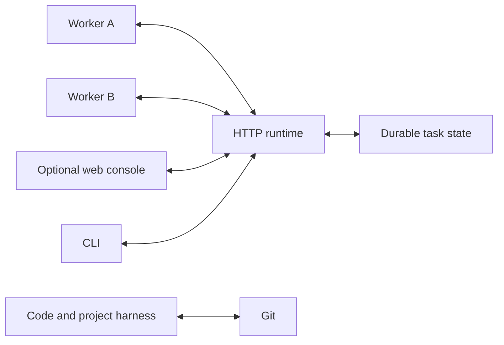

# Stackcord

> Coordinate AI work with bounded context. Keep the project when sessions change.

[](https://github.com/kcrmin/Stackcord/actions/workflows/ci.yml)
[](LICENSE)

[한국어](README.ko.md)

Stackcord is an open-source **coordination library and HTTP runtime** for AI workers.
Tasks, checkpoints and results outlive a worker's session. Workers exchange
structured requests through HTTP; **Git is not the message transport**. Git still
manages source, project decisions and harness configuration.

The runtime preserves work when a worker stops or reports a quota limit. Another
worker can claim eligible work and read its latest handoff. A returning old session
cannot overwrite the new owner's state. Read only the changed event IDs, then fetch
the context needed for the task. Idle coordination and the web console call no model.

**Version boundary:** this source checkout contains the new runtime; the published `v1.0.0`
plugin predates it. Build this checkout to try the runtime. No new release or
migration of existing Git channels is implied.

## Choose your interface

| Interface | Use it for |
| --- | --- |
| [Core library](core/README.md) | Embed task continuity in a Go application; no CLI, GUI or harness dependency |
| [CLI / HTTP](docs/guides/runtime-en.md) | Connect AI tools and scripts, checkpoint and resume work |
| Optional web console | Inspect tasks, ownership, reported usage and changes; create/requeue work |
| [Project harness](docs/guides/harness-en.md) | Existing Git, QDD, contracts, DBML, UI baseline and release workflows |

The GUI and CLI are adapters to the same core. They live in the same repository
under Apache-2.0. The library works without either one.

## Start a runtime

Build from this checkout using the Go version in `cli/go.mod`:

```sh
cd cli
go build -o ../dist/stackcord ./cmd/stackcord
```

Create a private credential file containing at least 32 random characters, then:

```sh
stackcord serve --db /absolute/private/path/state.db --token-file /absolute/private/path/token --ui
```

Use the built binary's path if it is not on PATH. The command binds
`127.0.0.1:7331` and runs in the foreground. `--ui` enables the optional console;
enter the credential in the page. It is kept in page memory only. No hosted account,
Node runtime, model API key or Git repository is required for coordination.

See the [runtime guide](docs/guides/runtime-en.md) for credential creation, the
A-to-B handoff example, remote connections and backup/restore.

## Small messages, durable work



- Stable project/task IDs survive replacement of worker sessions.
- Dependencies, expiring ownership leases and epochs prevent stale state updates.
- Idempotent mutations preserve retries without duplicate usage or events.
- Checkpoints retain completed work, next steps, blockers and artifact references.
- Project cursors return compact changes instead of entire conversation histories.
- Context byte budgets fail explicitly rather than truncating required constraints.
- Consistent database backups preserve state independently of source repositories.

These mechanisms reduce repeated context delivery. **No tokenizer-exact limit or
measured token-saving percentage is claimed.** Usage is optional and worker-reported;
unknown usage is not zero. Compare total tokens and successful outcomes, including
rework, before making a savings claim.

## Existing projects and limits

`stackcord harness` exposes the existing project workflow. Original commands such
as `stackcord status`, `stackcord channel` and `stackcord dashboard` remain as hidden
compatibility aliases. Their files, receipts and Git history are not migrated or
deleted. The old dashboard and signed Git channel belong to that extension.

The new runtime does not automatically execute models, reset quota, transfer a
model's private context or verify reported code results. Existing automatic host
runners stay in the harness. Workers use the new CLI/API explicitly. Lease expiry
does not prove a process has stopped: isolate code execution and verify Git results
before integration. One runtime token grants access to the whole trusted team;
use separate runtimes for untrusted tenants.

The live database is **authoritative state**, not a cache. Keep it outside Git,
back it up, and use local disk. Remote workers connect through HTTPS or an SSH
tunnel; never share the database file across computers.

## Development

- [Architecture and feature evaluation](docs/design/coordination-core.md)
- [Core API](core/README.md)
- [Runtime and migration](docs/guides/runtime-en.md)
- [Optional harness](docs/guides/harness-en.md)
- [Contributing and checks](CONTRIBUTING.md)
- [Security](SECURITY.md) · [License](LICENSE)
