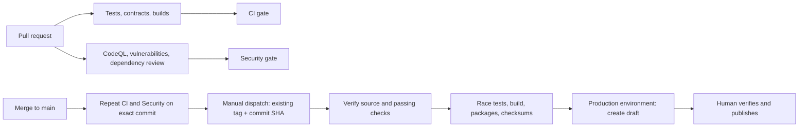

# Stackcord CI/CD

This guide describes this repository's pipeline. It is separate from the optional
harness's release verification for user projects.

## Flow

## Everyday checks

CI runs repository contracts, console tests and workflow validation. Code changes
also run the full Go suites on macOS ARM64 and Windows x64, focused Linux race
checks, the multi-repository scenario, and four-target cross-builds. README and
Markdown-only documentation changes skip the platform jobs. `CI gate` accepts
only the skips selected by this scope decision.

Security runs CodeQL and `govulncheck` independently across both Go modules.
Pull requests also run dependency review; moderate-or-higher new vulnerabilities
and the configured denied licenses block it. Full race tests and fuzzing run
weekly or through Security's manual dispatch. `Security gate` summarizes the
checks and rejects failures, cancellations and unexpected skips. No model calls
or AI tokens are part of these workflows.

New commits cancel obsolete CI/Security runs. Jobs have bounded timeouts. Go
caches include both modules; the Python scenario and console tests use explicit
Python/Node versions. Failed dogfood runs retain available reports as artifacts.

## Repository setup and troubleshooting

Dependency review requires **Settings → Advanced Security → Dependency graph**.
If the log says “Dependency review is not supported”, enable the graph, then
rerun the failed job. An administrator can also enable the graph and Dependabot
alerts with `gh api --method PUT repos/OWNER/REPO/vulnerability-alerts`. See
[GitHub's API documentation](https://docs.github.com/en/rest/repos/repos#enable-vulnerability-alerts).
The workflow deliberately fails when this prerequisite is missing.

Use `CI gate` and `Security gate` as required checks when configuring branch
protection. The workflow files alone do not enable branch protection. For a
failure, open the failed job named in the gate summary; vulnerability findings
belong to `Go vulnerabilities`, independently of CodeQL analysis.

## Prepare a release draft

After an authorized merge, wait for CI and Security to pass on the exact `main`
commit. Create the approved version tag at that commit, matching the Plugin
manifest version. Run **Stage verified candidate** from `main` with `tag` and
`expected_sha` (the full 40-character source commit). No tag is created by this
workflow. The former free-form `rc_digest` input is replaced by source identity
that the workflow can verify; this is not harness candidate or user-approval evidence.

The verifier rejects an unmerged/mismatched tag, missing checks, or a latest run
that failed, was cancelled or is still running. The read-only stage tests and
packages that exact source. The `production` environment then gates a separate
job with release write permission: it rechecks source/results, downloads this
run's artifacts, verifies checksums, and creates a draft. Configure environment
reviewers separately if approval before drafting is desired. An existing release
is not overwritten. Publication and real target-device validation remain explicit
human steps; a successful staging job does not claim production deployment.
