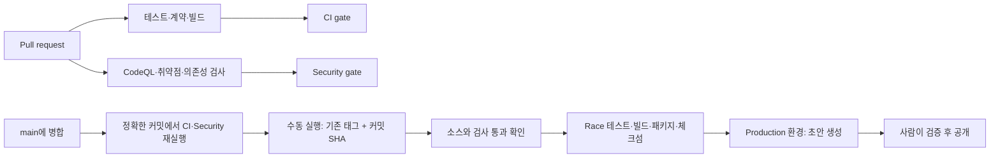

# Stackcord CI/CD

이 문서는 Stackcord 저장소 자체의 파이프라인을 설명합니다. 사용자 프로젝트를
위한 선택형 하네스의 release 검증과는 별개입니다.

## 흐름

## 평소 실행하는 검사

CI는 저장소 계약, 콘솔 테스트, workflow 검증을 실행합니다. 코드가 바뀌면
macOS ARM64·Windows x64의 전체 Go 테스트, Linux의 주요 race 검사,
여러 저장소를 사용하는 시나리오, 네 플랫폼 교차 빌드도 실행합니다. README와
Markdown 문서만 변경하면 플랫폼 작업을 생략합니다. `CI gate`는 이 범위 판단이
허용한 생략만 받아들입니다.

Security는 두 Go 모듈에 대해 CodeQL과 `govulncheck`를 독립적으로 실행합니다.
PR에서는 의존성 변경도 검사하며, 새로 들어온 moderate 이상 취약점과 설정된
금지 라이선스는 통과하지 못합니다. 전체 race·fuzz 검사는 매주 또는 Security의
수동 실행에서 진행합니다. `Security gate`는 결과를 요약하고 실패·취소·예상 밖
생략을 차단합니다. 이 workflow에는 모델 호출이나 AI 토큰 사용이 없습니다.

새 커밋이 올라오면 이전 CI·Security 실행을 취소합니다. 작업별 제한 시간이
있고, Go 캐시는 두 모듈을 모두 반영합니다. 시나리오와 콘솔 테스트의 Python·Node
버전도 명시합니다. Dogfood 실패 시 생성된 보고서는 artifact로 보관합니다.

## 저장소 설정과 문제 해결

의존성 검사에는 **Settings → Advanced Security → Dependency graph**가 필요합니다.
로그에 “Dependency review is not supported”가 나오면 그래프를 켜고 실패한
작업을 재실행합니다. 관리자는
`gh api --method PUT repos/OWNER/REPO/vulnerability-alerts`로 그래프와
Dependabot 알림을 함께 켤 수도 있습니다.
[GitHub API 문서](https://docs.github.com/en/rest/repos/repos#enable-vulnerability-alerts)를
참고하세요. 이 설정이 없으면 workflow는 통과하지 않습니다.

브랜치 보호를 설정할 때 필수 검사로 `CI gate`와 `Security gate`를 사용합니다.
Workflow 파일만으로 브랜치 보호가 활성화되지는 않습니다. 실패하면 gate 요약에
표시된 작업을 열어 확인합니다. 취약점 발견은 `Go vulnerabilities`에 나타나며
CodeQL 분석과 독립적으로 처리됩니다.

## 릴리스 초안 준비

승인된 병합 후 정확한 `main` 커밋에서 CI와 Security가 통과할 때까지 기다립니다.
Plugin manifest 버전과 일치하는 승인된 버전 태그를 해당 커밋에 만듭니다.
**Stage verified candidate**를 `main`에서 실행하고 `tag`와 전체 40자리 소스
커밋인 `expected_sha`를 입력합니다. Workflow는 태그를 만들지 않습니다.
기존 자유 입력 `rc_digest`는 실제 확인 가능한 소스 식별자로 대체했습니다.
이는 하네스 candidate 검증이나 사용자 승인 증거를 뜻하지 않습니다.

검증기는 미병합·불일치 태그, 누락된 검사, 최신 실행의 실패·취소·실행 중 상태를
차단합니다. 읽기 권한만 가진 단계가 정확한 소스를 테스트하고 패키징합니다.
이후 `production` 환경에서 별도 작업이 릴리스 쓰기 권한을 받아 소스와 검사
결과를 재확인하고, 같은 실행의 artifact를 내려받아 체크섬을 검증한 뒤 초안을
만듭니다. 초안 생성 전 승인이 필요하면 환경의 reviewer도 별도로 설정합니다.
기존 릴리스를 덮어쓰지 않습니다. 실제 기기 검증과 공개는 사람이 명시적으로
진행하며, staging 성공은 production 배포를 뜻하지 않습니다.
